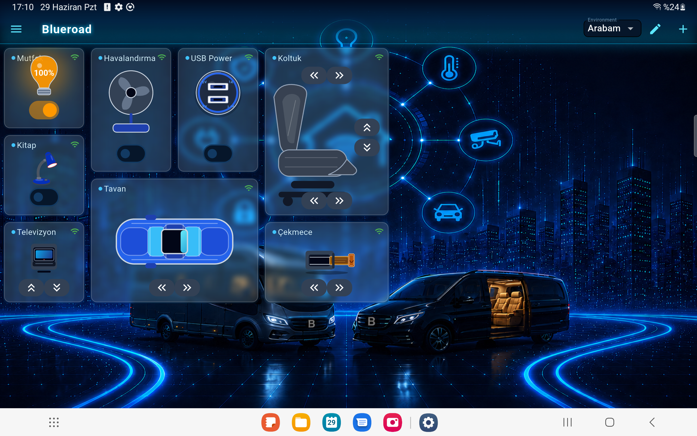
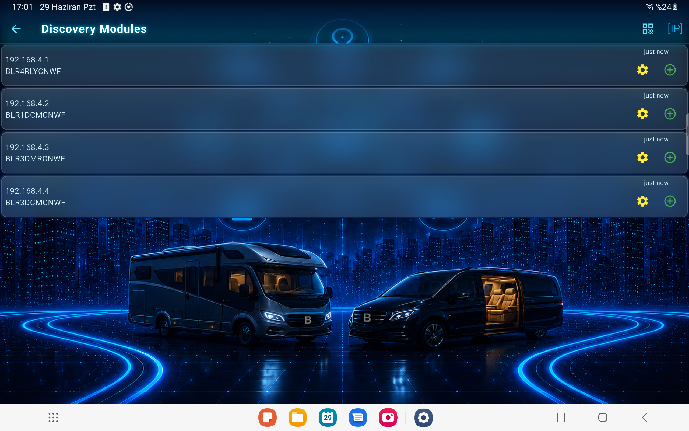
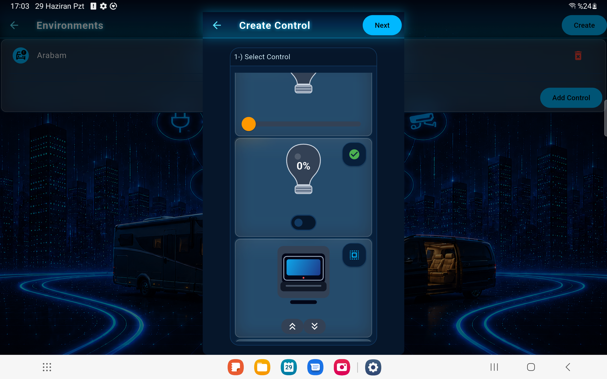
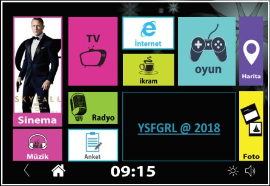

# Yusuf Uğurlu

**Bilgisayar Mühendisi · Mobil Uygulama · Backend · IoT**

Flutter ile iOS ve Android uygulamaları, Go ile backend servisleri ve mikroservisler geliştiriyorum. Otomotiv ve IoT projelerinde mobil uygulamalardan bağlı cihazlara uzanan ürünler üzerinde uçtan uca çalışıyorum.

[Portfolyo sayfasını görüntüle](./index.html)

## Öne çıkan teknolojiler

Flutter · Go · Python · REST API · Mikroservisler · MongoDB · Elasticsearch · Redis · RabbitMQ · Docker · MQTT · Linux

## Projeler

### TvBox

Araç içi multimedya sistemi ve Access Point çözümü. Yolcular ağa bağlandıktan sonra içerikleri çevrim dışı olarak görüntüleyebilir; internet bağlantısı olmasa da araç içi eğlence devam eder.

  
  

### BlueRoad Control

Araçlardaki koltuk, aydınlatma ve televizyon sistemlerini uygulama üzerinden kontrol etmeye yardımcı olan araç kontrol çözümü.

  
  
  

### Scorates

Mobil uygulama projesinden ekran görüntüleri:

  
  
  
  
  
  

### Busdroid

Otobüs arkası yolcu ekranları için gömülü Android uygulaması. Uydu üzerinden canlı yayın akışıyla yolculara seyahat sırasında televizyon içeriği sunar.

  

## İletişim

[E-posta](mailto:ugurlu.yusuf63@gmail.com) · [GitHub](https://github.com/yusuf.ugurlu)
